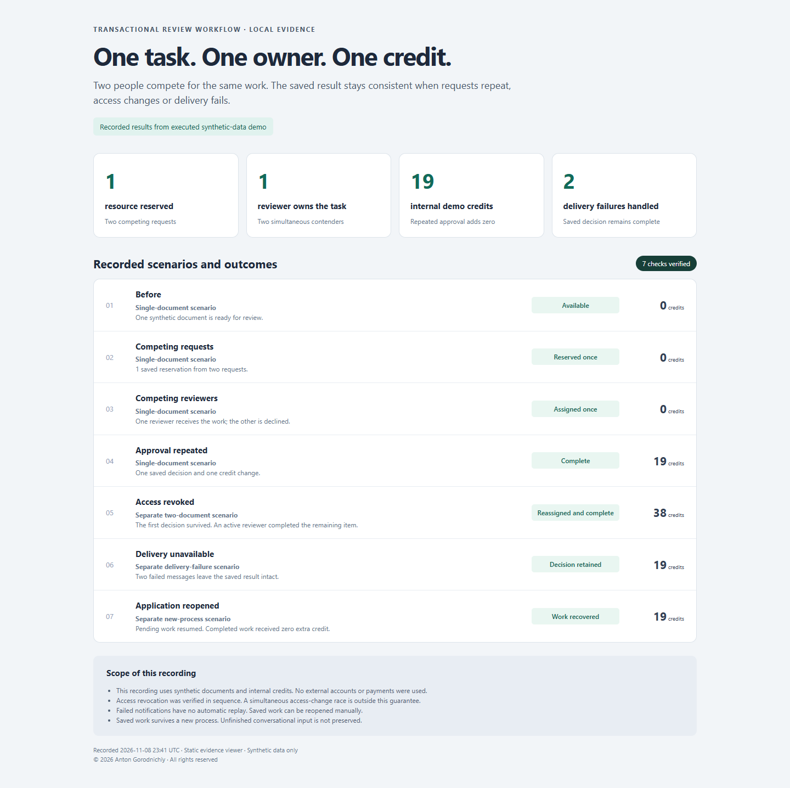
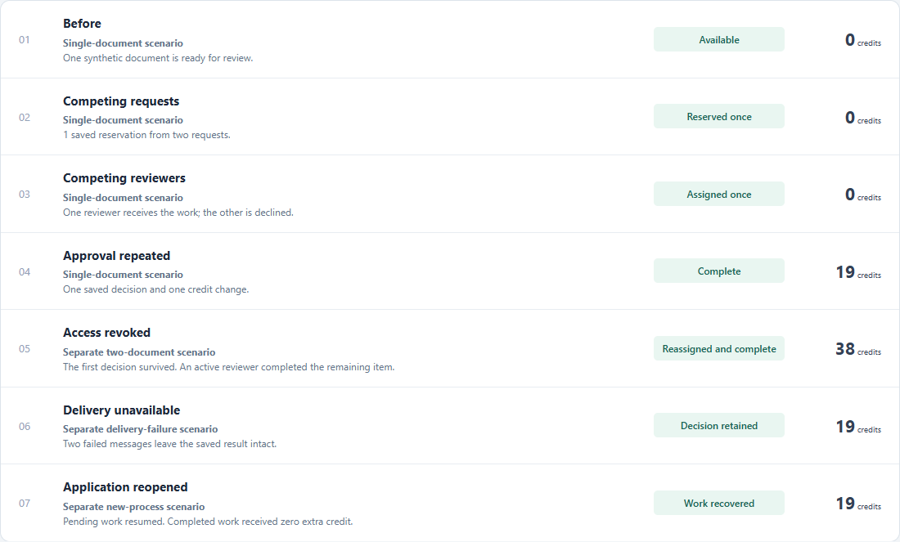
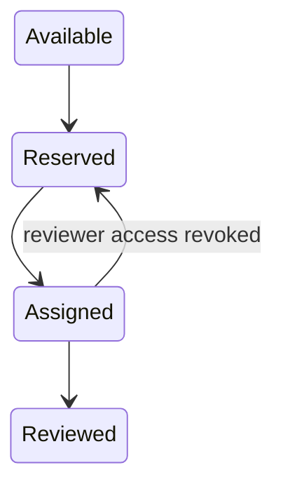

# Transactional Review Workflow

**Assign shared work once and keep the saved decision consistent when requests repeat.**

*Captured from local synthetic-data demo. This is a browser capture of **recorded results from an executed synthetic-data harness**, not a live Telegram interface or an illustrative reconstruction. The report's separate scenarios are labelled; credits are fictional internal units.*

## Problem → Solution → Result

Two people may compete for the same resource or work item. A repeated approval must not add a second credit. A private harness exercised selected unchanged original storage, reservation, staff and review-handler code with synthetic SQLite data and fake message delivery.

The observed result was one successful reservation, one assigned reviewer, and one credit change for a repeated approval. Separate checks covered sequential access revocation, failed post-commit notifications and saved work reopened in a new interpreter process.

## What this demonstrates

- Competing reservations and reviewer claims each have one winner in the checked scenario.
- Concurrent and repeated approval produce one saved decision and one credit change.
- A revoked reviewer is denied in the tested sequential flow; remaining work can be reassigned.
- Failed notifications preserve the committed decision. A fresh process reloads pending work and rejects an already completed review.
- **11 focused checks passed**. Selected original source hashes stayed unchanged. Checked 9 November 2026.

*Captured from local synthetic-data demo: recorded results viewer. The underlying workflow and process-restart checks actually ran. No external account or payment was involved.*

## How it works

**Original stack:** Python, aiogram 3, aiosqlite, SQLite and asyncio. The harness substitutes delivery at the external boundary while retaining the selected original logic. The technical invariant is one recorded result and credit update per reviewed item in the verified path.

## My contribution

I set the product requirements and review rules, directed AI-assisted development, and manually tested and diagnosed workflow problems. The private harness provides additional reproducible evidence for the selected original components.

## What I can deliver for a client

- A request or approval queue with staff roles and assigned ownership.
- Transactional reservations and guards against repeated actions.
- A focused Python bot fix with a repeatable regression check.

## Limitations / private source

The whole Telegram application and real delivery were not run. Concurrent role changes still need hardening; the tested sequential revocation is not a guarantee for that race. Notifications have no durable replay, and persisted work does not preserve unfinished conversational input. Load, deployment and production results are not claimed.

Private implementation — public case study. Source code is not publicly available.

[Discuss a similar workflow](CONTACT.md) · [Portfolio](PORTFOLIO.md)

© 2026 Anton Gorodnichiy. All rights reserved. [Rights and reuse](RIGHTS.md).
