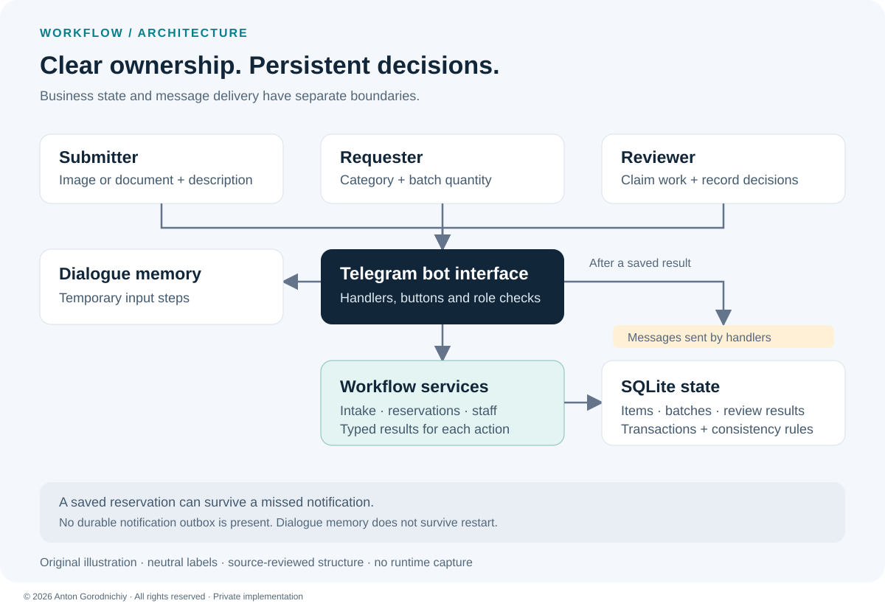
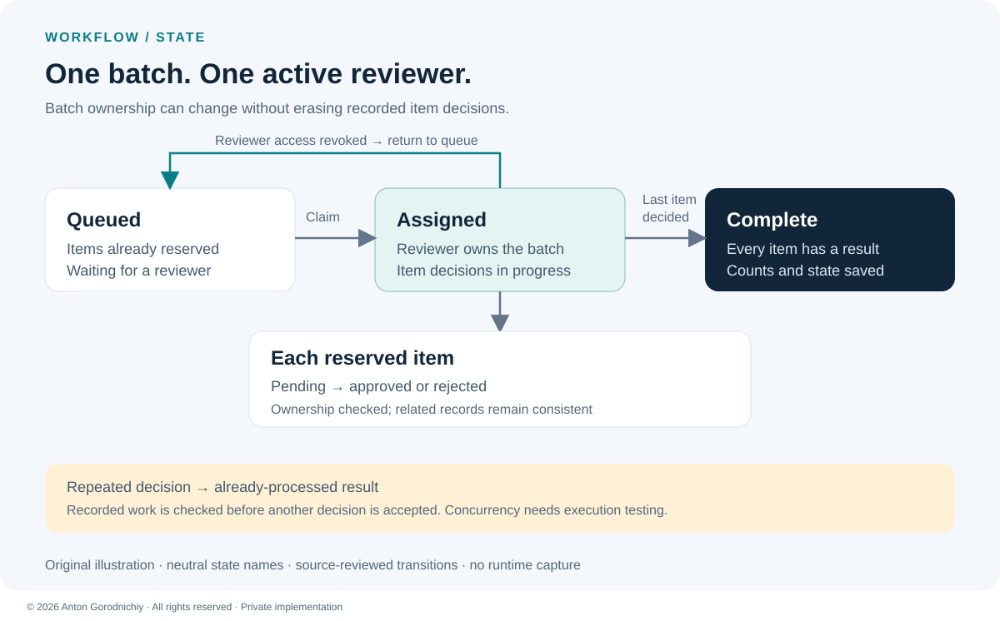

# Transactional Review Workflow

A Telegram workflow for collecting submissions, reserving a review batch and keeping each decision linked to the responsible reviewer.

**Private implementation — public case study. Source code is not publicly available.**

**Stack:** Python · aiogram 3 · aiosqlite · SQLite · asyncio  
**Status:** reviewed in source; execution not verified

## Problem → Solution → Result

| | Case |
| --- | --- |
| **Problem** | A shared review queue needs clear ownership. Two requests can compete for the same items, and repeated button clicks must not record a second decision. |
| **Solution** | Separate submission, reservation and staff services, backed by SQLite transactions and database constraints. Reviewers claim a batch and decide each item. |
| **Result** | The source contains persistent batch reservations, guarded review decisions and a path to return an unavailable reviewer's batch to the queue. These are implementation findings; runtime and production outcomes have not been verified. |

## Workflow at a glance

*Original explanatory diagram with neutral labels. This is an illustration of the source structure, not a screenshot.*

- **Submission intake:** accept an image or document with a description and category; store its Telegram file reference.
- **Batch reservation:** reserve available work as a complete batch or report that the requested quantity is unavailable.
- **Reviewer ownership:** claim queued work, resume an existing assignment and check ownership before accepting a decision.
- **One recorded decision:** approve or reject each reserved item and keep related records consistent.
- **Queue recovery:** when staff access is revoked, return the active batch to the queue and clear its reviewer assignment.

## Two engineering decisions

**Keep the check and the change together.** Database transactions and constraints protect related updates and limit conflicting assignments. These safeguards are present in the implementation; concurrent behavior still needs an executed test.

**Treat repeated review clicks as a state check.** Ownership and the saved result determine whether a decision is accepted. Previously processed work is recognized without applying the decision again.

*Original state diagram. Names are neutral; individual items keep their recorded decisions when a batch is reassigned.*

## My contribution

I defined the requirements and roles, designed the intake and review workflow, and implemented the Python bot, service layer and SQLite state model. I worked on the Telegram interaction flow, transaction boundaries and recovery behavior, using manual testing and diagnosis during development. The verification described here is a later source review; it does not reproduce those testing sessions.

## What I can build for a client

- A Telegram approval bot for document intake, content review or internal requests.
- A shared work queue with staff roles, batch assignment and duplicate-action guards.
- A small SQLite-backed operations tool with persistent status and reassignment workflows.

## Status & limitations

This is a substantive MVP. **reviewed in source; execution not verified** applies to the bot and its transaction behavior.

- No dedicated tests for this workflow were found in its own source tree; concurrency, restart and repeated-callback scenarios need an isolated test run.
- Database commits and Telegram notifications are separate. There is no durable notification outbox, so saved work can exist without a delivered message.
- In-progress dialogue uses memory storage and is lost after restart; saved reservations remain in SQLite.
- The system stores file references. It does not verify document authenticity, decode image contents or prove content uniqueness. Schema migration also needs a reproducible test on a database copy.

[Discuss a similar workflow](CONTACT.md)

© 2026 Anton Gorodnichiy. All rights reserved. [Rights and reuse](RIGHTS.md).
